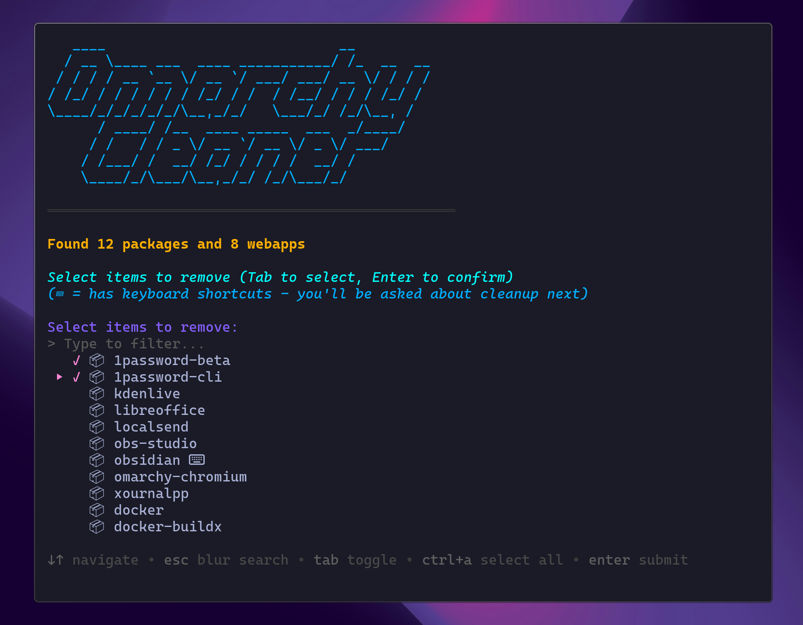

# Omarchy Cleaner

> If Omarchy is the omakase of Linux distros, a curated feast of pre-installed apps and webapps, Omarchy Cleaner is your trusty pair of chopsticks to pluck away the unwanted wasabi for a perfectly tailored system. 🥢

An interactive shell script to remove unwanted default applications and webapps from Omarchy installations with a clean, visual interface.



## Quick Start

```bash
curl -fsSL https://raw.githubusercontent.com/maxart/omarchy-cleaner/main/omarchy-cleaner.sh | bash
```

## How It Works

The script scans for Omarchy's default **packages**, **desktop launchers (webapps and TUIs)**, and **CLI wrappers**, then lets you choose what to remove. Nothing is preselected, and an itemized confirmation comes before removal.

The final confirmation shows descriptions to help you judge unfamiliar names. Packages use their pacman description; webapps, TUIs, and CLI tools use short functional summaries ([sources](docs/item-descriptions.md)). The selector searches names and category/shortcut labels only, so descriptions cannot change which name ranks first. Confirmation text wraps to fit your terminal.

Omarchy **4.0.6** is the live-validated release. Regression fixtures also cover 4.0.0, 4.0.2, 4.0.4, historical Quattro snapshots, and legacy 3.8.4 CLI wrappers. **4.5 release candidates and current Quattro are not fully supported:** their mise shims, additional packages, and new binding forms need separate compatibility work. See the [compatibility review](docs/v4.0.6-compatibility.md).

Shortcut cleanup removes supported literal single-line bindings from your personal config and disables packaged defaults in your `bindings.lua`, before your personal overrides. Packaged Omarchy files stay intact. Existing configs receive a unique timestamped backup before edits, and shortcuts are cleaned only after the associated removal succeeds. Multiline/computed Lua bindings, escaped strings, unsupported table fields, and ambiguous long-string layouts are left for manual editing.

Items marked **shortcut only** have a packaged shortcut but no desktop launcher. They are skipped if you decline shortcut cleanup. CLI removal deletes only recognized Omarchy wrappers in `~/.local/bin`; installed mise/npm runtimes, caches, and application data remain. Customized wrappers and symlinks are left alone.

Packages are removed in one `pacman -Rns` transaction, including unused dependencies and package backup configs. Only this step uses sudo; the script runs as your normal user. A read-only preview sets aside selected packages that other installed packages still need (Docker is needed by `ufw-docker`) and names them in the confirmation. Select the packages that need them to remove them together. The confirmation also lists every additional dependency pacman plans to remove. If the preview fails, nothing is removed; if the package set changes before removal, packages and their shortcuts are kept. Avoid running another package manager during cleanup.

Shortcut cleanup follows the removed command: removing Docker Compose or Buildx keeps Docker's TUI shortcut, and removing `1password-cli` keeps the 1Password desktop shortcut.

## Customization

Edit `DEFAULT_APPS`, `DEFAULT_WEBAPPS`, `DEFAULT_TUIS`, and `DEFAULT_NPM_CLIS` in the script to customize the offering. The active package list covers Omarchy's own removable defaults, with additional applications and detected leftovers from older releases. Other default packages remain as commented entries you can uncomment.

## Upstream sources

The catalogues track Omarchy's [base packages](https://github.com/omacom/omarchy/blob/quattro/install/omarchy-base.packages), [desktop launchers](https://github.com/omacom/omarchy/tree/quattro/applications), [CLI installers](https://github.com/omacom/omarchy/blob/quattro/install/user/mise.sh), and [Remove Preinstalls command](https://github.com/omacom/omarchy/blob/quattro/bin/omarchy-remove-preinstalls). Packaged shortcuts come from [applications.lua](https://github.com/omacom/omarchy/blob/quattro/default/hypr/bindings/applications.lua).

## Verification

```bash
bash -n omarchy-cleaner.sh
shellcheck omarchy-cleaner.sh
python3 -m unittest discover -s tests -v
```

Tests use temporary home directories and stubbed system commands, so they do not uninstall software. Their upstream fixtures cover Quattro 4.0.0/4.0.2/4.0.4/4.0.6, Quattro snapshots through `10f1cbf`, and the legacy 3.8.4 npx installer. See [fixture provenance](tests/fixtures/README.md), the [Quattro review](docs/quattro-review.md), the [Quattro catalogue comparison](docs/quattro-catalogue-10f1cbf.md), and the [4.0.6 compatibility review](docs/v4.0.6-compatibility.md). A live TUI/removal smoke test belongs on a disposable Omarchy VM.

GitHub Actions runs syntax, lint, and isolated regression checks for pull requests and main. Real-gum selector checks also run when `gum` is installed (or `CLEANER_TEST_GUM` names its executable). They use a temporary home and stubbed system commands. Runtime changes still require the [disposable VM workflow](skills/omarchy-vm-testing/SKILL.md); CI alone does not establish live Omarchy compatibility.

## License

 Omarchy Cleaner is released under the [MIT License](https://opensource.org/licenses/MIT).
